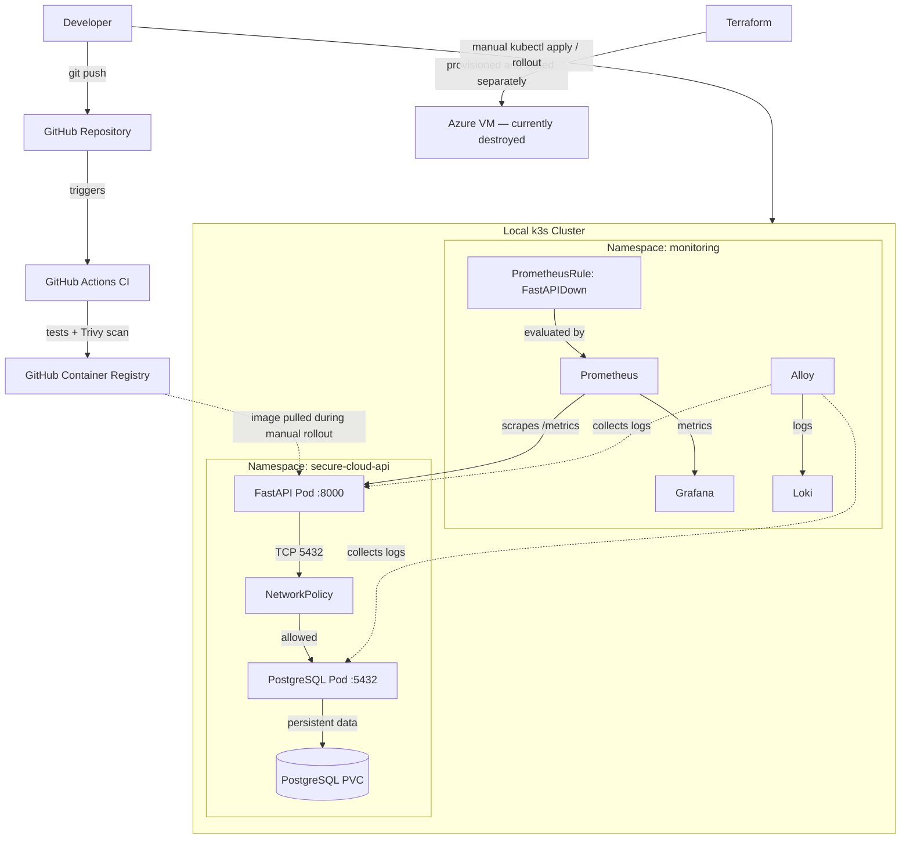
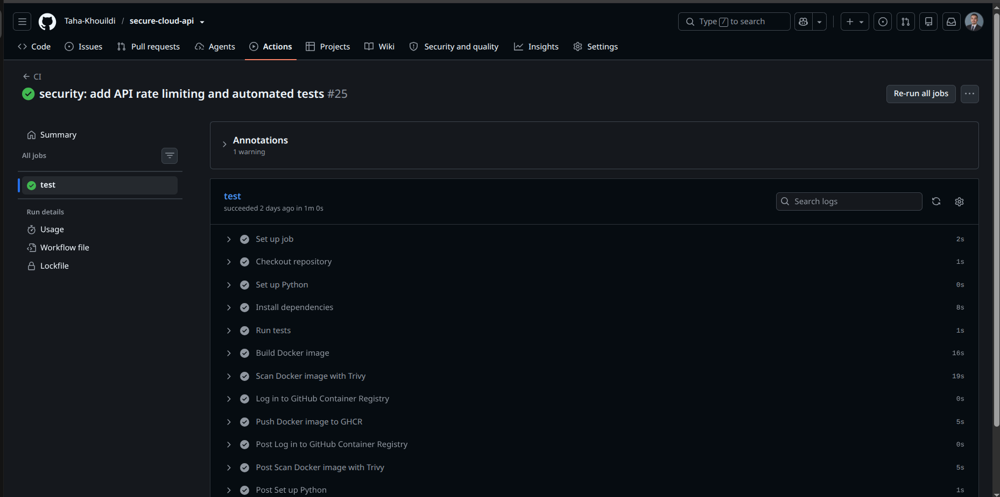
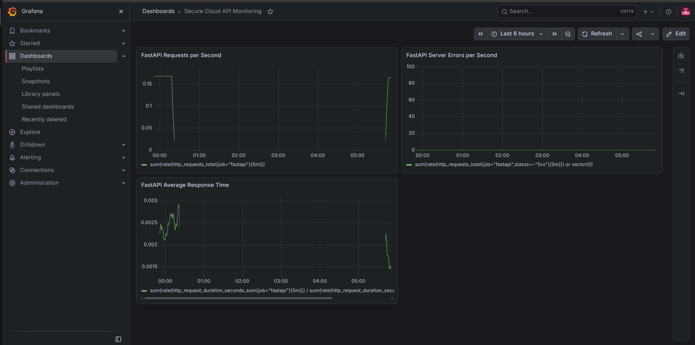

# Secure Cloud API

I built a Todo API with FastAPI and PostgreSQL. I use Docker Compose locally, Terraform for Azure infrastructure, k3s for local Kubernetes testing, and GitHub Actions for testing, scanning, and image publishing.

I record implementation decisions, test results, and remaining limitations in [notes.md](notes.md). I distinguish settings in repository files from behavior I tested.

**Current status**

- I tested API/database health, Todo creation and retrieval, and the security fixes below on my local k3s deployment.
- I rotated the PostgreSQL password from 6 to 48 bytes, then checked `/db-health` and `/todos`: authentication succeeded and both existing records remained accessible. I preserved the [API responses in notes.md](notes.md#evidence-supplement-todo-records-after-password-rotation).
- I tested `FastAPIDown` firing and clearing, and viewed FastAPI and PostgreSQL logs through Loki. I recorded the [results in notes.md](notes.md#stage-5--earlier-monitoring-observations); I did not preserve screenshots of the alert transitions or exported Loki logs.
- I provisioned Azure infrastructure, connected through SSH, and destroyed the resources in an earlier session. Full application deployment with the current bootstrap is **not verified**.
- I accept PostgreSQL’s unconfined AppArmor profile only for local development. Fresh-cluster initialization is **not verified**; I have not implemented authentication, TLS, or external alert notification, or completed ZAP and broader security testing.

## Contents

1. [Local Docker Compose](#1-local-docker-compose)
2. [Azure Deployment](#2-azure-deployment)
3. [CI and Image Publishing](#3-ci-and-image-publishing)
4. [Local Kubernetes Deployment](#4-local-kubernetes-deployment)
5. [Security Findings](#5-security-findings)
6. [Monitoring and Evidence](#6-monitoring-and-evidence)
7. [Operating Guides](#7-operating-guides)
8. [Limitations and Next Work](#8-limitations-and-next-work)

## Architecture



## Repository map

| Path | Configuration or implementation |
| --- | --- |
| [app/](app/) | FastAPI routes, PostgreSQL access, request-size middleware |
| [db/init.sql](db/init.sql) | Initial Todo table schema |
| [tests/](tests/) | API, metrics, request-size, and rate-limit tests |
| [compose.yaml](compose.yaml), [Dockerfile](Dockerfile) | Local containers and non-root API image |
| [compose.deploy.yaml](compose.deploy.yaml) | GHCR image override for Azure |
| [terraform/](terraform/) | Azure resources and cloud-init bootstrap |
| [k8s/](k8s/) | Deployments, Services, storage, NetworkPolicy, ServiceMonitor |
| [monitoring/](monitoring/) | Prometheus/Grafana, Loki/Alloy, dashboard, alert rule |
| [security-tests/](security-tests/) | Isolated PostgreSQL read-only filesystem test |
| [.github/workflows/ci.yml](.github/workflows/ci.yml) | Tests, image build, Trivy scan, GHCR publishing |
| [docs/](docs/) | Azure, Kubernetes, and troubleshooting guides |
| [notes.md](notes.md) | Recorded results, earlier observations, and limitations |

## 1. Local Docker Compose

Prerequisites: Git, Docker Engine, and the Docker Compose plugin. The images use Python 3.14 and PostgreSQL 18; see [Dockerfile](Dockerfile) and [compose.yaml](compose.yaml).

I documented the following commands for configuring the local stack. A complete clean-clone run is **not verified**.

```bash
git clone https://github.com/Taha-Khouildi/secure-cloud-api.git
cd secure-cloud-api
cp .env.example .env
nano .env
```

Set `POSTGRES_PASSWORD` privately in `.env`. No password value is included here. Keep `.env` and real credentials out of Git.

```bash
sudo docker compose up -d --build
sudo docker compose ps
curl http://127.0.0.1:8000/health
curl http://127.0.0.1:8000/db-health
curl http://127.0.0.1:8000/todos
```

I implemented `/health` to return `{"status":"ok"}` and `/db-health` to return `{"database":"connected"}` when its database query succeeds. `/todos` returns an array of saved records. These are expected responses for this Compose setup; my recorded runtime checks below were on k3s.

Create a Todo:

```bash
curl -i -X POST http://127.0.0.1:8000/todos \
  -H "Content-Type: application/json" \
  -d '{"title":"Learn DevOps"}'
```

I implemented HTTP `201` for successful creation and title validation of 1–255 characters. I have not implemented Todo update or deletion routes. Source: [app/main.py](app/main.py).

### API interface

| Method and path | Implemented behavior |
| --- | --- |
| `GET /health` | Application health response without a database query |
| `GET /db-health` | Database connectivity query |
| `GET /todos` | List Todos ordered by ID |
| `POST /todos` | Insert a Todo using a parameterized SQL value |
| `GET /metrics` | Prometheus metrics endpoint |

I define these behaviors in [app/main.py](app/main.py). I use runtime checks, rather than configuration alone, to verify a deployment.

I configured Compose to publish only the API at `127.0.0.1:8000`, with no PostgreSQL host port mapping. I mount the named database volume at `/var/lib/postgresql`.

```bash
sudo docker compose down
```

This preserves the named database volume. Adding `--volumes` deletes its data. Initialization SQL runs when PostgreSQL initializes an empty data directory; it does not migrate existing databases. Compose has no service health checks or startup dependencies. Source: [notes, section 10](notes.md#10-container-configuration-and-storage).

## 2. Azure Deployment

The [Azure guide](docs/azure.md) contains prerequisites, Terraform provisioning, SSH access, cloud-init checks, application deployment, and resource cleanup.

[Terraform](terraform/main.tf) defines nine Azure resources, including an Ubuntu 24.04 VM (`Standard_B1ms`) in `francecentral`. Its SSH rule uses the configured source IPv4 address with `/32`. The [bootstrap](terraform/cloud-init.yaml) installs Docker, Compose, and Git, then clones the repository; secrets and application startup remain manual.

I recorded successful infrastructure provisioning, SSH access, destruction, and resource-group removal in [notes, section 12](notes.md#12-azure-infrastructure-with-terraform). Current Azure resource state and a complete application deployment using the current bootstrap are **not verified**. I present expected application responses in the guide as instructions, rather than Azure test results.

## 3. CI and Image Publishing

The [workflow](.github/workflows/ci.yml) runs on pushes and pull requests. It installs dependencies with Python 3.14, runs pytest, builds the image, and scans it with Trivy. Fixable `HIGH` and `CRITICAL` vulnerabilities fail the gate; unfixed findings are ignored by that gate.

Successful pushes to `main` publish:

```text
ghcr.io/taha-khouildi/secure-cloud-api:latest
```

The Azure Compose override uses `latest`; Kubernetes FastAPI uses a digest. Publishing does not automatically deploy either environment.

I added [tests](tests/) for health, metrics, the `nosniff` header, malformed JSON, request-size rejection including streamed bodies, a separate SlowAPI test application, and unrestricted health requests. Comprehensive PostgreSQL integration coverage is **not verified**.

I recorded 6 passing tests for the [size-limit change](notes.md#finding-missing-http-request-body-size-limit), then 8 passing tests and a successful workflow for the [rate-limit change](notes.md#finding-missing-api-rate-limiting). Those counts describe the corresponding test sessions. I have not rerun the application suite for this documentation update.



## 4. Local Kubernetes Deployment

The [Kubernetes guide](docs/kubernetes.md) contains prerequisites, SQL ConfigMap creation, application manifest application, rollout checks, Service port forwarding, and monitoring resource application.

The [manifests](k8s/) define FastAPI and PostgreSQL Deployments and ClusterIP Services, a PostgreSQL PVC, readiness probes, and an ingress NetworkPolicy. Credentials use `postgres-secret`; initialization SQL uses `postgres-init`.

I tested Todo creation/retrieval, database connectivity, existing-data access after enabling the read-only root filesystem, and blocking an unrelated Pod. I recorded the [results in notes.md](notes.md#stage-4--kubernetes-postgresql-debugging). Fresh-cluster initialization is **not verified**: I had to create the database and table manually on the existing volume.

### Container settings

| Workload | Configured controls |
| --- | --- |
| FastAPI | UID `10001`, non-root execution, disabled privilege escalation, dropped capabilities, read-only root filesystem, `RuntimeDefault` seccomp |
| PostgreSQL | Read-only root filesystem, `RuntimeDefault` seccomp, PVC at `/var/lib/postgresql`, writable runtime and temporary volumes |

Sources: [FastAPI Deployment](k8s/api-deployment.yaml), [PostgreSQL Deployment](k8s/postgres-deployment.yaml). The [NetworkPolicy](k8s/postgres-networkpolicy.yaml) allows PostgreSQL ingress on TCP `5432` from `app=fastapi` Pods in the same namespace. It defines no egress restrictions; credentials remain necessary.

### Resource configuration

| Workload | CPU request / limit | Memory request / limit |
| --- | --- | --- |
| FastAPI | `100m` / `500m` | `128Mi` / `512Mi` |
| PostgreSQL | `100m` / `1` | `256Mi` / `1Gi` |

I configured the current manifests with these values. During the [recorded resource-limit test](notes.md#finding-missing-kubernetes-cpu-and-memory-limits), I used a FastAPI memory limit of `256Mi`. Runtime behavior with the current `512Mi` limit and suitability under load are **not verified**.

### FastAPI image pinning

The Deployment references the digest recorded in [notes.md](notes.md#finding-mutable-docker-image-tag):

```text
ghcr.io/taha-khouildi/secure-cloud-api@sha256:df533118daac9271dd03e38c9d1489f8aac530a456f0976802d5e726dca4adad
```

I set `imagePullPolicy: IfNotPresent`, applied the update, checked that the Deployment referenced the intended digest, and confirmed `/db-health` returned `{"database":"connected"}`. For future releases, I need to update the digest deliberately and check the rollout. I still use `postgres:18` for PostgreSQL and FastAPI `latest` in Azure Compose.

### Accepted PostgreSQL startup risks

**AppArmor:** I set `appArmorProfile: Unconfined` after startup failures and suspected compatibility problems. I [accept this risk only for local development](notes.md#accepted-risk-postgresql-apparmor-unconfined). This removes AppArmor confinement; my compensating controls are the read-only root filesystem, explicit writable volumes, seccomp, NetworkPolicy, resource limits, and the rotated 48-byte password.

**Root-then-gosu startup:** I [inspected the process users](notes.md#postgresql-startup-user-and-remaining-hardening-limitation): default `kubectl exec` used UID 0, while the PostgreSQL server ran as `postgres`. I identified the image’s root-then-`gosu` privilege-dropping startup behavior. My manifest does not enforce non-root startup, which remains a hardening limitation. The exec UID alone does not establish the server process's user. I did not preserve the process listing or entrypoint artifact.

Before production, I need to resolve the AppArmor compatibility issue and enable an appropriate profile. I also need to verify initialization and volume-permission compatibility before enforcing non-root startup.

## 5. Security Findings

I recorded the following findings and results in [notes.md](notes.md#finding-missing-fastapi-kubernetes-security-context). I tested the stated paths and configurations; a broader security assessment remains **not verified**.

| Finding | How found | Before evidence | Fix | After evidence | Status |
| --- | --- | --- | --- | --- | --- |
| FastAPI security context | Trivy configuration scan | 3 HIGH findings: KSV-0014 and KSV-0118 | UID 10001, no privilege escalation, read-only root, dropped capabilities, RuntimeDefault seccomp | 0 HIGH; rollout succeeded; `/health`, `/db-health`, `/metrics`: HTTP 200 | Fixed and verified |
| PostgreSQL Pod security context | Trivy KSV-0118 | No Pod security context; 2 HIGH findings | Pod RuntimeDefault seccomp | 1 HIGH; KSV-0118 absent; rollout and database connectivity succeeded | Fixed and verified |
| PostgreSQL writable root | Trivy KSV-0014; isolated read-only test | HIGH finding; read-only test crashed on `/var/run/postgresql` lock file | Read-only root; PVC and writable runtime/temporary mounts | 0 manifest misconfigurations; Todo count 1; `/db-health` connected | Fixed and verified |
| PostgreSQL reachable from unrelated Pods | BusyBox connection test | `db (10.43.240.9:5432) open`; no NetworkPolicy | Allow ingress from same-namespace FastAPI Pods on 5432 | Unrelated test exited 1; FastAPI database check connected | Fixed for tested paths |
| Missing resource requests/limits | Deployment inspection using kubectl | Both resource configurations returned `{}` | Requests/limits for both workloads; recorded FastAPI memory limit 256Mi | Rollouts and `/db-health` succeeded; resource settings present | Fixed for recorded configuration; current 512Mi runtime not verified |
| Missing request-body limit | 10 MB JSON request to `POST /todos` | HTTP 422 | 1 MiB limit on declared and received bytes | Deployed 10 MB request: HTTP 413; 6 tests passed | Fixed and verified |
| Missing rate limiting | Request test and code review | 200 `/health` requests: 200 HTTP 200; no limiter in code | SlowAPI, 60/minute/client IP on Todo endpoints | 65 `GET /todos`: 60 HTTP 200, 5 HTTP 429; 8 tests passed | Verified for tested endpoint; **not a like-for-like test** |
| Weak PostgreSQL password | Secret metadata inspection | 6 bytes | Rotate to 48 characters; update database/Secret; restart FastAPI | Secret: 48 bytes; `/db-health` connected; both existing Todos returned after rotation | Verified; both records accessible after rotation |
| Mutable FastAPI image tag | Deployment reference inspection | `latest`; content drift not measured (confirmed by code review) | Pin recorded SHA-256 digest; IfNotPresent | Deployment reference matched; `/db-health` connected | Fixed and verified |
| PostgreSQL AppArmor unconfined | Startup investigation and kernel logs | `/db-health`: HTTP 500; `pg_isready`: no response; AppArmor DENIED messages | Unconfined workaround with compensating controls | PostgreSQL accepted connections | Accepted risk for local development |

I used different endpoints for the rate-limit before and after checks. `/health` remains unrestricted. My after test verified limiting on `GET /todos`; it was **not a like-for-like test** of the earlier `/health` requests.

I implemented request-size enforcement and rate limits in [app/request_size.py](app/request_size.py) and [app/main.py](app/main.py). My rate counters are in process memory and are not shared across replicas; I still need to address client-IP handling behind proxies. I added the `nosniff` header in code; deployed header verification is **not verified**.

## 6. Monitoring and Evidence

Configuration sources: [ServiceMonitor](k8s/api-servicemonitor.yaml), [FastAPIDown rule](monitoring/fastapi-alerts.yaml), [Prometheus/Grafana values](monitoring/values.yaml), [Loki values](monitoring/loki-values.yaml), and [Alloy values](monitoring/alloy-values.yaml).



| Check | Recorded evidence and limits |
| --- | --- |
| FastAPIDown firing and clearing | I scaled FastAPI to zero and observed PENDING → FIRING. After I restored one replica, the alert returned to INACTIVE. |
| Loki log visibility | I viewed FastAPI and PostgreSQL logs in Grafana through Loki, with namespace, Pod, and container labels. |
| External alert notification | I have not implemented an external notification channel; delivery is **not verified**. |
| PostgreSQL startup user | I confirmed UID 0 for default exec and the main PostgreSQL server running as `postgres`, with root-then-`gosu` startup. |

I recorded these interactive test results in [notes.md](notes.md#stage-5--earlier-monitoring-observations). I did not preserve screenshots of the alert transitions, timestamped alert logs, exported Loki queries, or the process listing. I plan to repeat those checks and save their outputs.

### Evidence categories

- **Tested:** I observed the result during a documented test session.
- **Preserved output:** I included the API responses in notes.md, as with post-rotation Todo retrieval.
- **Interactive observation:** I recorded the result in notes.md but did not save a separate supporting artifact, as with alert transitions and Loki logs.
- **Configuration:** I implemented a setting or behavior in a repository file; runtime verification requires a test.
- **Not verified:** I have no recorded result for the claimed outcome.

## 7. Operating Guides

| Guide | Moved content |
| --- | --- |
| [Azure](docs/azure.md) | Infrastructure prerequisites/configuration, provisioning, SSH, cloud-init, application setup, verification instructions, teardown |
| [Kubernetes](docs/kubernetes.md) | Core resources, deployment steps, rollout checks, port forwarding, initialization caveat, monitoring resource application |
| [Troubleshooting](docs/troubleshooting.md) | Diagnostic checklist and Compose log commands |

I moved the detailed commands into these guides. They remain operating instructions; I have not verified every command as a complete deployment sequence or performed a deployment during this documentation update.

## 8. Limitations and Next Work

- I have not implemented API authentication, authorization, or TLS termination.
- I have not implemented external alert notification; delivery is **not verified**.
- I have not completed ZAP or broader security testing; their results are **not verified**.
- Fresh-cluster initialization and a clean-clone Compose run are **not verified**.
- Full Azure application deployment with the current bootstrap and current Azure resource state are **not verified**.
- I retain the local PostgreSQL AppArmor exception and have not enforced non-root startup.
- Resource-limit load suitability, current FastAPI 512Mi runtime behavior, and multi-replica rate-limit consistency are **not verified**.
- I still use mutable PostgreSQL and Azure application image references, and I have not implemented automated deployment or rollback.
- I have not implemented managed secrets, database migrations, backup/restore, or high availability. Their operational readiness is **not verified**.
- I need to preserve artifacts when I repeat the monitoring and startup-user checks. Database persistence across a Pod replacement is **not verified**; I checked existing records after hardening and password rotation, which are narrower tests.
- Comprehensive database integration tests and deployed `nosniff` header verification are **not verified**.

I keep the journal and test evidence in [notes.md](notes.md). The repository is [Taha-Khouildi/secure-cloud-api](https://github.com/Taha-Khouildi/secure-cloud-api).
