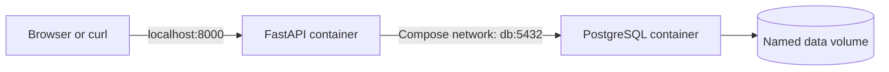

# Secure Cloud API

A Todo REST API built with FastAPI and PostgreSQL, packaged with Docker Compose. This portfolio project brings together local development, automated testing, container scanning, image publishing, and Azure infrastructure managed with Terraform.

**Current status:** Local Compose setup, a health endpoint test, and a GitHub Actions pipeline are implemented. Azure provisioning, SSH access, and cleanup have previously been verified. The repository also includes VM bootstrapping and a Compose override for deploying the published image; application deployment remains a manual step.

## Contents

- [What it does](#what-it-does)
- [Architecture](#architecture)
- [Quick start](#quick-start)
- [API reference](#api-reference)
- [Configuration and storage](#configuration-and-storage)
- [Development and testing](#development-and-testing)
- [CI and container publishing](#ci-and-container-publishing)
- [Azure deployment](#azure-deployment)
- [Everyday commands](#everyday-commands)
- [Troubleshooting](#troubleshooting)
- [Repository layout](#repository-layout)
- [Security and roadmap](#security-and-roadmap)

## What it does

- Creates todos with validated titles and stores them in PostgreSQL.
- Lists todos in ascending ID order.
- Provides separate application and database health endpoints.
- Persists database data in a Docker named volume.
- Provides interactive API documentation through FastAPI.

The application image uses Python 3.14, and the database uses PostgreSQL 18. Python dependencies are pinned in [requirements.txt](requirements.txt).

## Architecture



The same Compose stack runs locally or on an Azure Ubuntu VM. On the VM, the API stays bound to loopback and is accessed through an SSH tunnel. Terraform creates the infrastructure; cloud-init installs Docker, Compose, and Git and clones the repository. Starting the application is a separate manual step.

## Quick start

### Prerequisites

- Git to clone the repository.
- Docker Engine or Docker Desktop with Docker Compose available through `docker compose`.
- Port `8000` available on your machine.
- `curl` for the request examples below, or a browser for the interactive documentation.

Clone the repository, then run the remaining commands from its root directory:

```bash
git clone https://github.com/Taha-Khouildi/secure-cloud-api.git
cd secure-cloud-api
```

1. Create your local configuration:

   ```bash
   cp .env.example .env
   ```

   Edit `.env` and replace the placeholder with a local database password:

   ```dotenv
   POSTGRES_PASSWORD=replace_with_local_password
   ```

   `.env` is excluded from Git and the Docker build context.

2. Build and start both services:

   ```bash
   docker compose up --build -d
   ```

3. Check the containers and database readiness:

   ```bash
   docker compose ps
   docker compose exec db pg_isready -U todo_user -d todo_db
   ```

   On the first run, PostgreSQL needs time to initialize. Repeat the readiness check until it reports that it is accepting connections. Compose currently has no health checks or startup dependencies, so running containers alone do not confirm database readiness.

4. Verify the API:

   ```bash
   curl http://localhost:8000/health
   curl http://localhost:8000/db-health
   ```

   Expected responses, respectively:

   ```json
   {"status":"ok"}
   ```

   ```json
   {"database":"connected"}
   ```

Open [Swagger UI](http://localhost:8000/docs) to try the endpoints, or [ReDoc](http://localhost:8000/redoc) to read the API reference. The OpenAPI schema is available at [`/openapi.json`](http://localhost:8000/openapi.json).

## API reference

Base URL: `http://localhost:8000`

| Method | Endpoint | Purpose | Success status |
| --- | --- | --- | --- |
| `GET` | `/health` | Check that the application responds; does not query the database | `200` |
| `GET` | `/db-health` | Check database connectivity by executing `SELECT 1` | `200` |
| `GET` | `/todos` | List all todos ordered by ID | `200` |
| `POST` | `/todos` | Create a todo | `201` |

### Create a todo

```bash
curl -i -X POST http://localhost:8000/todos \
  -H 'Content-Type: application/json' \
  -d '{"title":"Verify the local Docker setup"}'
```

Example response body (the generated ID may differ):

```json
{"id":1,"title":"Verify the local Docker setup","completed":false}
```

`title` is required and must contain between 1 and 255 characters. Invalid request bodies return HTTP `422`. New todos default to `completed: false`; the create endpoint only accepts `title` as a defined input field.

### List todos

```bash
curl http://localhost:8000/todos
```

Example response:

```json
[
  {"id":1,"title":"Verify the local Docker setup","completed":false}
]
```

An empty database returns `[]`. Updating, completing, and deleting todos are not implemented yet.

## Configuration and storage

Compose reads `POSTGRES_PASSWORD` from the root `.env` file and supplies it to both services. It also configures the API's database connection:

| API variable | Compose value | Purpose |
| --- | --- | --- |
| `DB_HOST` | `db` | Database service name on the Compose network |
| `DB_PORT` | `5432` | Internal PostgreSQL port |
| `DB_NAME` | `todo_db` | Database name |
| `DB_USER` | `todo_user` | Database user |
| `DB_PASSWORD` | Value of `POSTGRES_PASSWORD` | Database password |

The API is published on `127.0.0.1:8000`. PostgreSQL has no published host port; the API connects to it over the Compose network.

The `todo-postgres-data` named volume stores PostgreSQL data at `/var/lib/postgresql` inside the database container. [db/init.sql](db/init.sql) creates the `todos` table when PostgreSQL initializes an empty data directory. It is an initialization script, not a migration system: editing it does not update an existing database.

Changing `POSTGRES_PASSWORD` in `.env` also does not change the password stored in an initialized database. Keep the values consistent, or reset the disposable local database as described below.

## Development and testing

For local tests, use Python 3.14 and a virtual environment:

```bash
python3.14 -m venv .venv
source .venv/bin/activate
python -m pip install -r requirements-dev.txt
python -m pytest -v
```

The current suite contains one test in [tests/test_health.py](tests/test_health.py). It uses FastAPI's `TestClient` to verify the `/health` response and does not need a running database. Database connectivity and todo persistence are currently checked manually with the requests above; they are not covered by automated tests.

The container copies application code into its image, so rebuild it after source changes:

```bash
docker compose up --build -d api
```

## CI and container publishing

The [GitHub Actions workflow](.github/workflows/ci.yml) runs on pushes and pull requests. It:

1. Sets up Python 3.14 and installs the development dependencies.
2. Runs `python -m pytest -v`.
3. Builds the application image as `secure-cloud-api:test`.
4. Scans that image with Trivy, failing on fixable `HIGH` or `CRITICAL` vulnerabilities. Unfixed findings are ignored by this check.
5. On pushes to `main`, authenticates with `GITHUB_TOKEN` and publishes `ghcr.io/taha-khouildi/secure-cloud-api:latest` after the preceding checks pass.

Pull requests do not publish images. The workflow does not deploy to Azure; the VM must pull and start the published image manually. The deployment override uses the mutable `latest` tag, so its contents change after successful builds on `main`.

## Azure deployment

### Infrastructure and prerequisites

The configuration in [terraform/](terraform/) provisions:

- A resource group in `francecentral`.
- A virtual network (`10.0.0.0/16`) and subnet (`10.0.1.0/24`).
- A Network Security Group attached to the subnet, with an SSH rule restricted to your supplied public IPv4 address (`/32`).
- A static Standard public IP and network interface.
- An Ubuntu 24.04 LTS VM (`Standard_B1ms`) with a 32 GB Standard SSD and the `azureuser` administrator account.

You need Terraform, the Azure CLI, an Azure subscription with permission to create these resources, and an SSH key pair. Confirm that your subscription permits the configured VM size and region and has sufficient quota.

The VM configuration expects the public key at `~/.ssh/azure_secure_cloud_api.pub`. If that key pair does not already exist, create it:

```bash
ssh-keygen -t ed25519 -f ~/.ssh/azure_secure_cloud_api
```

### Provision the VM

Authenticate and choose your subscription:

```bash
az login
az account set --subscription "YOUR_SUBSCRIPTION_ID"
export ARM_SUBSCRIPTION_ID="$(az account show --query id -o tsv)"
```

Create `terraform/terraform.tfvars`, replacing the example address with your current public IPv4 address, without a CIDR suffix:

```hcl
ssh_allowed_ip = "203.0.113.10"
```

Terraform variable files and state files are excluded from Git. From the repository root:

```bash
cd terraform
terraform init
terraform validate
terraform plan
terraform apply
```

The AzureRM provider is configured with `resource_provider_registrations = "none"` because automatic registration stalled during an earlier deployment. Required Azure resource providers must already be registered in the subscription; if provisioning reports a missing provider registration, resolve it before retrying.

Retrieve the VM address and connect from your local terminal:

```bash
VM_PUBLIC_IP=$(az network public-ip show \
  --resource-group rg-secure-cloud-api \
  --name pip-secure-cloud-api \
  --query ipAddress -o tsv)

ssh -i ~/.ssh/azure_secure_cloud_api "azureuser@$VM_PUBLIC_IP"
```

### Start the application on the VM

[terraform/cloud-init.yaml](terraform/cloud-init.yaml) installs `docker.io`, `docker-compose-v2`, and `git`, then clones this repository into `/opt/secure-cloud-api`. It does not create `.env` or start containers.

Run these commands in the SSH session. Wait for cloud-init to finish successfully before continuing:

```bash
sudo cloud-init status --wait
sudo docker compose version
cd /opt/secure-cloud-api
sudo install -m 600 .env.example .env
sudoedit .env
```

Set `POSTGRES_PASSWORD` to a database password of your choice. Create this file once; preserve the password when restarting an existing database.

The [deployment override](compose.deploy.yaml) removes the local build configuration and selects the GHCR image. Both Compose files are required:

```bash
sudo docker compose -f compose.yaml -f compose.deploy.yaml pull
sudo docker compose -f compose.yaml -f compose.deploy.yaml up -d
sudo docker compose -f compose.yaml -f compose.deploy.yaml ps
sudo docker compose -f compose.yaml -f compose.deploy.yaml exec db \
  pg_isready -U todo_user -d todo_db
```

The image must have been published by a successful push to `main`. If the GHCR package is private, authenticate with `sudo docker login ghcr.io -u YOUR_GITHUB_USERNAME` using a token with permission to read the package before pulling.

Once PostgreSQL reports that it is accepting connections, verify the API on the VM:

```bash
curl http://localhost:8000/health
curl http://localhost:8000/db-health
```

To update the application later, repeat the `pull` and `up -d` commands with both Compose files. Cloud-init only clones the repository during initial provisioning; image updates do not update the checked-out Compose or schema files.

### Access the API from your computer

In a local terminal with `VM_PUBLIC_IP` set as above, open a tunnel and keep it running:

```bash
ssh -i ~/.ssh/azure_secure_cloud_api \
  -L 8000:127.0.0.1:8000 -N "azureuser@$VM_PUBLIC_IP"
```

Open [Swagger UI](http://localhost:8000/docs) or use the same local request examples. Local port `8000` must be free; stop your local Compose stack first if it is using that port. The deployment does not expose the API directly on the VM's public IP.

### Clean up Azure resources

When finished, run the following locally from `terraform/`, using the same subscription and Terraform state as provisioning:

```bash
terraform plan -destroy
terraform destroy
az group exists --name rg-secure-cloud-api
```

The final command should return `false`. Destroying this infrastructure deletes the VM and its database data. The Docker volume persists across container restarts on that VM, but is not a backup and does not survive infrastructure deletion. Keep your Terraform state until cleanup is complete so Terraform can track the resources it created.

## Everyday commands

```bash
# Inspect service status
docker compose ps

# Follow application and database logs (Ctrl+C exits the log viewer)
docker compose logs -f api db

# Rebuild the API after changing its source or dependencies
docker compose up --build -d api

# Open a PostgreSQL shell
docker compose exec db psql -U todo_user -d todo_db

# Stop and remove containers and the network, keeping database data
docker compose down
```

To reset the local database, run the following commands. **This permanently deletes the Compose database volume and all stored todos.**

```bash
docker compose down --volumes
docker compose up --build -d
```

## Troubleshooting

These Docker commands assume a local checkout. On the VM, use `sudo docker compose -f compose.yaml -f compose.deploy.yaml` in place of `docker compose`.

| Symptom | What to check |
| --- | --- |
| Docker cannot connect to its daemon | Start Docker Engine or Docker Desktop, then retry. |
| Port `8000` is already in use | Stop the conflicting process, or change the host port in `compose.yaml` and adjust the example URLs. |
| `/health` works but `/db-health` or `/todos` fails | Check `docker compose logs db api`, confirm PostgreSQL is ready, and verify the configured password matches the initialized database. |
| `todos` table is missing after changing `init.sql` | Initialization scripts only run against an empty data directory. Apply the schema manually or reset the disposable local database. |
| SSH to Azure times out | Confirm the VM is running and `ssh_allowed_ip` matches your current public IPv4 address; apply the updated Terraform configuration if your address changed. |
| cloud-init fails or the repository is missing on the VM | Inspect `sudo cloud-init status --long` and `/var/log/cloud-init-output.log`. |
| Pulling the deployment image fails | Confirm CI published the image and authenticate to GHCR if the package is private. |
| The VM's public IP does not serve port `8000` | Use the SSH tunnel above; the API binds to loopback and there is no public API ingress rule. |

## Repository layout

```text
.
├── .github/workflows/
│   └── ci.yml            # Tests, Docker build, Trivy scan, and GHCR publishing
├── app/
│   ├── main.py           # FastAPI application, request model, and routes
│   └── database.py       # PostgreSQL connection configuration
├── db/
│   └── init.sql          # Initial todos schema
├── terraform/
│   ├── main.tf           # Azure network, SSH rule, and Ubuntu VM
│   ├── providers.tf      # AzureRM provider configuration
│   ├── variables.tf      # Allowed SSH source address
│   └── cloud-init.yaml   # Install Docker/Compose/Git and clone the repository
├── tests/
│   └── test_health.py    # Application health test
├── .env.example         # Local configuration template
├── compose.yaml         # API, database, network, and persistent volume
├── compose.deploy.yaml  # Override to run the published GHCR image
├── Dockerfile           # Python application image
├── requirements.txt     # Pinned Python dependencies
├── requirements-dev.txt # Runtime dependencies plus pytest and httpx
├── notes.md             # Development journal; some progress notes are historical
└── README.md
```

## Security and roadmap

Current controls include:

- Parameterized SQL values for todo creation and request title length validation.
- An application container running as the unprivileged `appuser` (UID `10001`), with `pip` removed from the final image.
- A loopback-only API port and no published PostgreSQL host port.
- SSH key authentication with password login disabled and an ingress rule restricted to one public IPv4 address.
- Git exclusions for `.env`, Terraform variables, and Terraform state, plus a Docker build-context exclusion for `.env`.
- A CI image scan for fixable high and critical vulnerabilities.

This remains a learning project: authentication, authorization, application TLS, rate limiting, database backups, and migrations are not implemented. The image scan is one check, not a guarantee that the application is secure. Keep access limited while those controls are developed.

Planned work includes:

- Add database integration tests for todo creation, listing, and invalid input.
- Add service readiness checks and database migrations.
- Verify the full application deployment on Azure and automate deployment after CI.
- Add authentication, TLS, backups, and stronger secret management.
- Publish versioned images for repeatable deployments and rollback.
- Explore k3s deployment, monitoring, and security testing.
